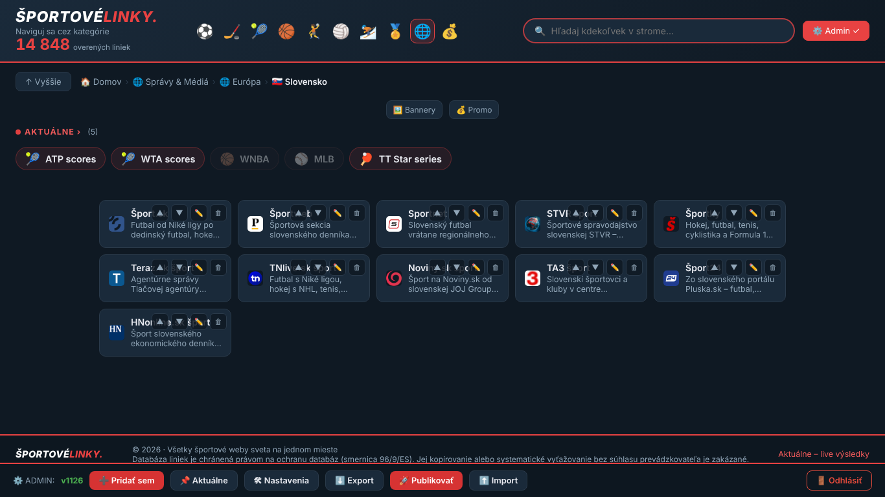
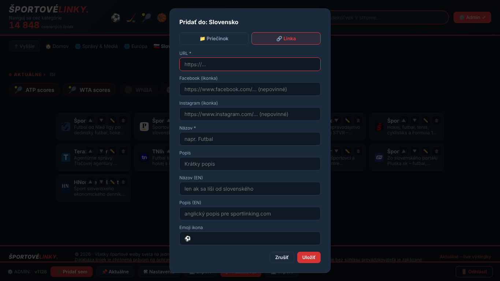
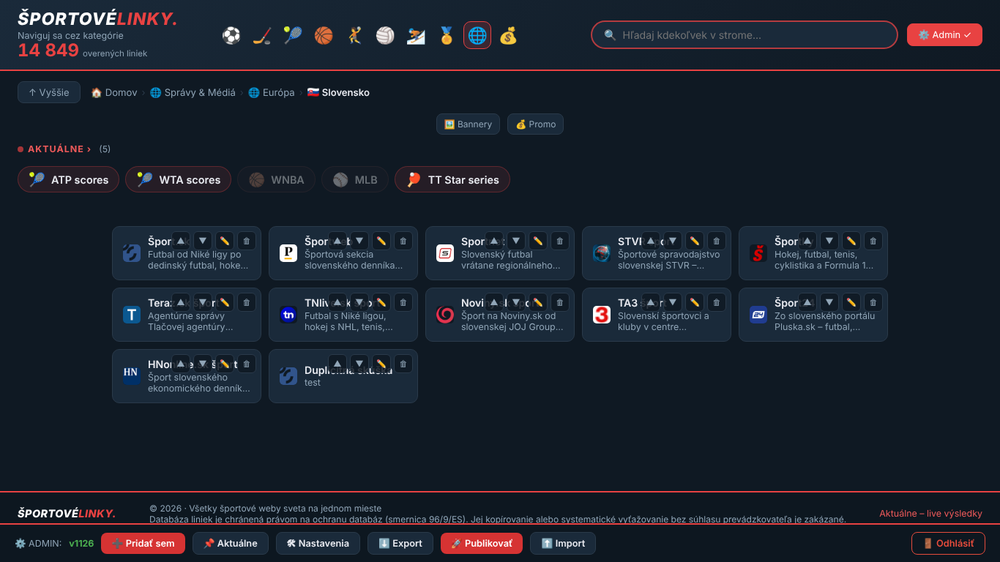
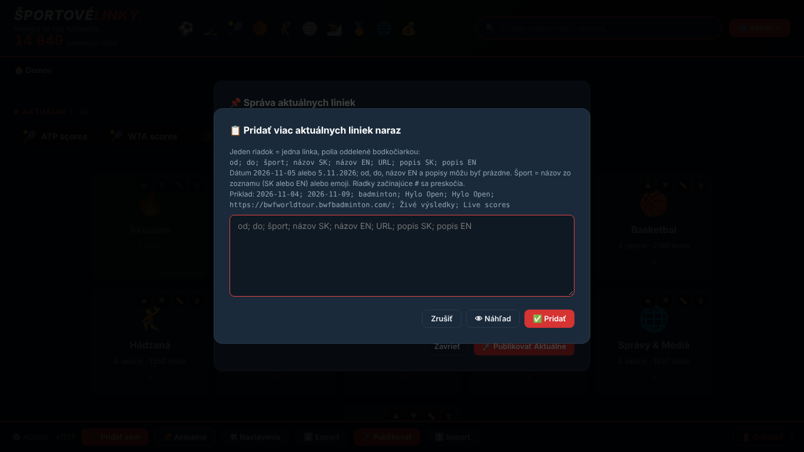
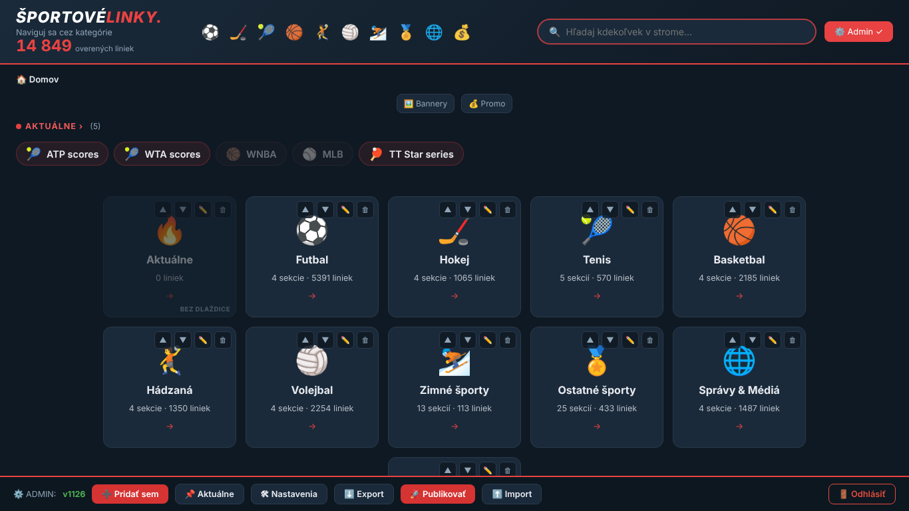
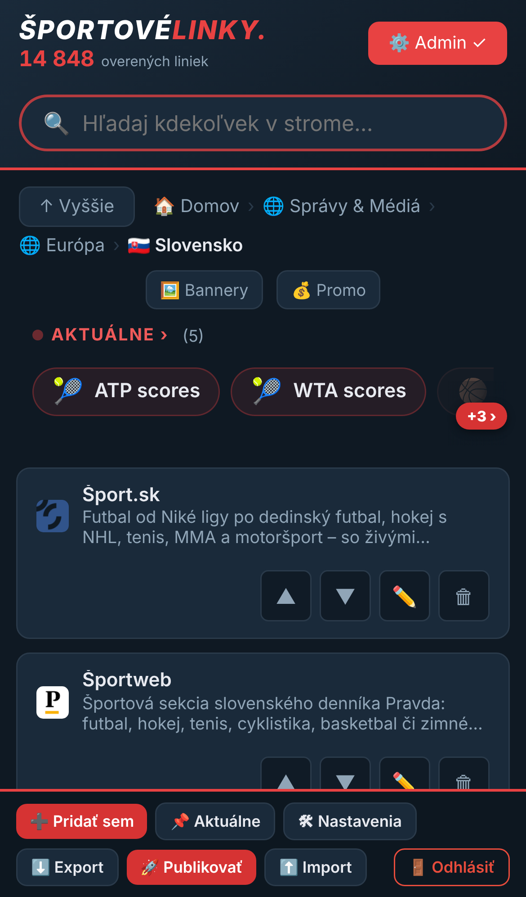
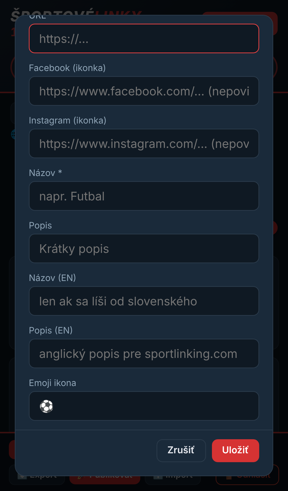
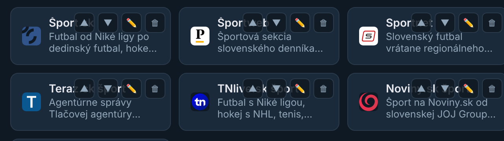

# Zadanie 40 — Analýza admin režimu a návrh zjednodušenia (6. 11. 2026)

**Len správa, kód sa nemenil.** Nezmenil som `index.html`, `generator.py`, `data.json`, `aktualne.json` ani `sitemap-lastmod.json`. Pribudla iba táto správa a priečinok `navrhy/admin-analyza/` so snímkami, skriptom prechodu a jeho výsledkami.

**Ako som testoval:** Živý web je z cloudu nedostupný, preto som SK aj EN web vygeneroval lokálne do pomocného priečinka mimo repozitára. Dáta boli z `data.json` v1126. Admin som prechádzal v prehliadači Chromium (Playwright = program, ktorý za mňa kliká v prehliadači) na počítači (1366×768) aj v napodobenom iPhone 13. Tvoje heslo nepoznám. Do lokálnej kópie dát som preto vložil vlastné testovacie heslo. Na živom webe sa nič nezmenilo.

Pred analýzou som prečítal previerky 1–3 (hlavne `previerka-3/A2-admin.md`) a zmeny zo Zadaní 31 a 33. Nenavrhujem znova vyriešené ani zamietnuté veci:
- žiadne dátumy na webe,
- admin ostáva len po slovensky,
- Aktuálne ostávajú jeden zoznam bez skupín.

---

## Zhrnutie (pre rýchle čítanie)

1. **Pridať linku dnes znamená 8 políčok.** Vyplniť ich musíš 5: adresu, názov, popis, EN názov a EN popis. EN popis má dnes **každá** zo 14 848 liniek, no admin ťa naň neupozorní. Okno nekontroluje **duplicitu** (rovnakú linku som uložil 2× v tom istom priečinku bez slova). Adresu bez `https://` iba odmietne, sám ju neopraví.
2. **Linku ligy (štítok LIGA, poradie −1) v admine vyrobiť nejde.** Nová linka sa vždy zaradí na koniec a cez linku ligy ju posunúť nemožno. Dnes to vie len Cowork.
3. **Poradie meníš len o 1 miesto na klik.** Presun poslednej položky na začiatok v priečinku Správy › Európa (53 položiek) = **52 kliknutí** na ▲. Polovica väčších priečinkov (550 z 1 010) je dnes zoradená abecedne, no nová linka sa do abecedy sama nezaradí.
4. **Najväčší prínos za najmenšiu námahu:** múdrejšie okno linky (doplní `https://`, upozorní na duplicitu a chýbajúcu angličtinu, pribudne „typ linky: LIGA“) a **hromadné vloženie liniek do priečinka** v rovnakom štýle, ako to už majú Aktuálne.
5. **Poradie:** odporúčam samostatný „režim poradia“, teda zoznam, kde položky ťaháš alebo dáš „na začiatok / na koniec“ a potom raz uložíš. Generátor sa kvôli tomu meniť nemusí. Prepínač „abecedne / ručne“ pre priečinok je možný, ale väčší a zasahuje aj generátor.
6. **Publikovanie priamo na GitHub z admina zatiaľ neodporúčam.** Na stránke beží cudzí skript (počítadlo návštev GoatCounter) a „kľúč“ ku GitHubu uložený v prehliadači by sa dal ukradnúť. S ním by útočník mohol zmeniť celý web. Odporúčam bezpečné zjednodušenie: po Publikovať okno s krokmi a tlačidlom rovno na nahrávanie súboru na GitHub.
7. **Nová chyba na počítači:** tlačidlá ▲▼✏️🗑 na kartách prekrývajú názov linky (snímka nižšie). Na mobile je to po Zadaní 31 v poriadku.

---

## A) Pridávanie a úprava liniek

### Dnešný stav

**Postup pridania linky (overené v prehliadači):**

| Krok | Kliky | Poznámka |
|---|---|---|
| Prihlásenie `/#admin` + heslo | 1 + Enter | |
| Prechod do priečinka (Domov › Správy & Médiá › Európa › Slovensko) | 3 | |
| ➕ Pridať sem | 1 | kurzor skočí rovno do poľa URL ✅ |
| Vyplniť polia | 5 polí (URL, Názov, Popis, Názov EN, Popis EN) | okno má spolu **8 polí** + prepínač Priečinok/Linka |
| Uložiť | 1 | linka sa pridá **na koniec** priečinka |
| Posunúť na správne miesto | 0 až 50+ × ▲ | |
| 🚀 Publikovať → nahrať na GitHub | 1 + ~5 na GitHube | viď časť C |

**Úprava linky:** ✏️ na karte, zmena a Uložiť = 2 kliky. Okno je rovnaké ako pri pridaní (8 polí).

**Čo je povinné:** len URL a Názov. Zvyšok admin nepýta.

**Kde sa dá pomýliť (každý bod overený):**

| Riziko | Čo sa stane dnes | Čísla z dát (v1126, len čítanie) |
|---|---|---|
| Adresa bez `https://` (napr. `sportnet.sme.sk`) | hláška „adresa musí začínať https://“ a musíš ju prepísať; admin ju sám neopraví | — |
| **Duplicita** | uloží sa **bez upozornenia**. Overil som to: adresa Šport.sk 2× v priečinku Slovensko | tá istá adresa je v dátach **387×** na viacerých miestach (väčšinou zámerne, napr. klub v lige mužov aj žien); **3×** v tom istom priečinku |
| Zabudnutý **Názov (EN)** | na sportlinking.com sa ukáže slovenský názov. Pole má popis „len ak sa líši“, preto sa ľahko vynechá | **9 liniek** so slovenským slovom bez EN názvu, všetky v Správach & Médiách: „Teraz.sk šport“, „TA3 šport“, „Šport TV“… (EN web ich ukazuje po slovensky) |
| Zabudnutý **Popis (EN)** | na EN webe sa ukáže slovenský popis | EN popis má dnes **100 %** liniek (14 848). Admin by mohol vyrobiť prvú bez neho |
| FB / IG | kontroluje sa len `https://`. Keď je hlavná linka sama na Facebooku, ikonka FB sa ukáže automaticky — pole FB netreba | 5 269 liniek má FB, 7 366 IG; **0** zle zapísaných (FB pole s inou adresou) |
| **Ikonka** | pole „Emoji ikona“ má sivú ukážku ⚽, ktorá **vyzerá ako vyplnená** (snímka vyššie). Pri linkách je skoro zbytočné: ikonku webu stiahne build sám (`ikony.py`, najviac 720 nových za beh) | 1 746 liniek má v poli ikona **kód krajiny** (`jp`, `cn`…) = náhradná vlajka. Okno to nikde nevysvetľuje |
| **Linka ligy (LIGA, order −1)** | **nedá sa vyrobiť**: nová linka dostane poradie „počet položiek“ (koniec). ▲ ju cez −1 nepustí („linka ligy ostáva navrchu“). Zmeniť ju na −1 nejde | 794 liniek ligy (−1), 17 rýchlych liniek (−2), 10 so štítkom `tag: scores` — všetky vznikli v Cowork |
| Pridanie do Aktuálnych cez „Pridať sem“ | blokované hláškou (Zadanie 31) ✅ | — |

**Pre porovnanie — hromadné vloženie v Aktuálnych (`openAktBulk`) funguje dobre:** jeden riadok = jedna linka, polia oddelené bodkočiarkou, 👁 Náhľad označí chybné riadky ❌ a duplicitné adresy ⚠️, až potom ✅ Pridať. Pre linky v priečinkoch nič také nie je.

**Pozor na sieť (CORS):** CORS je ochrana prehliadača. Stránka sportlinky.sk si nesmie sama stiahnuť obsah cudzieho webu (napr. sportnet.sme.sk), aby z neho prečítala názov alebo popis. **Predvyplniť názov podľa skutočnej stránky preto v admine nejde.** Obchádzky cez cudzie „preposielacie“ služby (proxy) neodporúčam: posielali by tvoje linky tretej strane, často nefungujú a museli by sme oslabiť bezpečnostné pravidlá webu (CSP). Z adresy samotnej však predvyplniť **dá** (pozri A1). Skutočné názvy a popisy môže doplniť Cowork. Alebo `strazca_liniek.py`, ktorý linky aj tak navštevuje, môže zapisovať názov stránky (`<title>`) do **návrhového súboru** v `navrhy/` pre Cowork — nikdy nie rovno do `data.json`.

### Varianty

**A1 — Múdrejšie okno linky** · náročnosť **malá až stredná** · len `index.html`
- **Adresa:**
  - chýbajúce `https://` admin doplní sám,
  - odstráni sledovacie prívesky (`?utm_…`, `fbclid`),
  - adresu z Instagramu vloženú do poľa FB (a naopak) zachytí.
- **Názov z adresy:** z `sportnet.sme.sk` navrhne „Sportnet“, z `www.hcslovan.sk` „Hcslovan“. Je to len návrh, prepíšeš ho. Funguje bez siete.
- **Duplicita v celých dátach:** pri uložení upozorní „Táto adresa už je v: Futbal › Slovensko › Niké liga“ s voľbou **Pridať aj tak / Zrušiť**. Má to byť len upozornenie, nie zákaz, lebo 387 adries je v dátach zámerne viackrát.
- **Angličtina:**
  - Ak chýba **Popis (EN)**, admin sa opýta „Uložiť bez anglického popisu?“.
  - Ak názov obsahuje slovenské slovo (šport, správy, ženy, muži, zväz, pohár…) a **Názov (EN)** je prázdny, upozorní.
- **Poradie polí:** URL › Názov › Popis › Názov EN › Popis EN. Pod tým zbalené **„▸ Viac“**: Facebook, Instagram, Ikonka/vlajka, Typ linky. Na mobile sa tak z 8 polí stane 5 viditeľných.
- **Typ linky:**
  - Bežná,
  - **Linka ligy (LIGA)**: zapíše poradie −1, dá ju navrch a FB/IG ikonky sa pri nej nekreslia (ako dnes),
  - Rýchla linka (−2).
- **Ikonka:** odstrániť sivú ukážku ⚽, aby nevyzerala ako vyplnená. Popisok zmeniť na „Ikonka alebo kód vlajky (nepovinné — ikonku webu doplní build sám)“.
- **Zaradiť:** na koniec (ako dnes) / na začiatok / abecedne.
- **Tlačidlo „Uložiť a pridať ďalšiu“:** okno ostane otvorené pre ďalšiu linku do toho istého priečinka.
- Riziká: malé. Mení sa len okno, dáta majú rovnaký tvar ako dnes. Linka ligy cez admin pribudne s tými istými poľami, aké dnes zapisuje Cowork.

**A2 — Hromadné vloženie liniek do priečinka** · náročnosť **stredná** · len `index.html`
- Nové tlačidlo „📋 Pridať viac naraz“ v admin lište (vidno ho len v priečinku, nie na domove ani v Aktuálnych).
- **Navrhovaný formát riadku** (rovnaké poradie ako v Aktuálnych, len bez dátumov a športu):
  `názov SK; názov EN; URL; popis SK; popis EN; FB; IG; liga`
  - povinné sú len **názov SK** a **URL**, ostatné môže byť prázdne,
  - posledné pole `liga` = napíš `liga`, ak je to linka ligy (−1),
  - riadok s `#` na začiatku sa preskočí,
  - dá sa vložiť aj tabuľka z Excelu (stĺpce oddelené tabulátorom = neviditeľným znakom medzi stĺpcami).
  - Príklad: `Sportnet; ; sportnet.sme.sk; Slovenský futbal vrátane regionálneho; Slovak football incl. regional; ; https://www.instagram.com/sportnet.sk/`
- **👁 Náhľad** (ako v Aktuálnych):
  - ✅ riadok v poriadku,
  - ❌ chyba (chýba URL, zlá adresa, priveľa polí),
  - ⚠️ upozornenie: duplicita v celých dátach (s cestou), chýba EN popis, slovenské slovo bez EN názvu.
  - `https://` sa doplní automaticky.
- Nové linky sa pridajú na koniec (alebo podľa voľby „abecedne“ z A1).
- Riziká: malé až stredné. Bodkočiarka vnútri popisu by rozbila riadok, ale náhľad to zachytí („priveľa polí“), rovnako ako v Aktuálnych.

**A3 — Presun a kópia** · náročnosť **stredná** · `index.html`
- V okne ✏️ tlačidlá **„📦 Presunúť do…“** a **„⧉ Kopírovať do…“**. Otvorí sa výber priečinka s hľadaním (ako hľadanie na webe). Linka sa zaradí na koniec cieľa.
- **Linky:** bez rizika, adresa linky sa nemení.
- **Priečinky:** pozor, presun **zmení adresu stránky na webe** (napr. `/futbal/slovensko/…` sa zmení na `/futbal/europa/slovensko/…`). Stará adresa, ktorú pozná Google, prestane fungovať (chyba 404 = stránka neexistuje). Preto navrhujem najprv presun **len liniek**. Priečinky iba s výrazným varovaním, prípadne neskôr s presmerovaním (to by bola zmena v generátore).
- Admin nedovolí presun priečinka do jeho vlastného podpriečinka (zacyklenie).

**Odporúčanie A:** najprv **A1**, hneď potom **A2**. Spolu ušetria najviac času v Správach & Médiách a odstránia najčastejšie chyby (duplicita, slovenské názvy na EN webe, nemožnosť pridať linku ligy). **A3** až potom, a najprv len pre linky.

---

## B) Poradie

### Dnešný stav

- **Čísla v dátach:** každá položka má `order` (číslo, menšie = vyššie). EN web radí podľa `order_en`, ak ho položka má (2 905 položiek v 311 priečinkoch), inak podľa `order`.
- **Záporné čísla:** −1 = linka ligy so štítkom LIGA, −2 = rýchle linky. Vždy ostávajú navrchu, ▲▼ cez ne nepustí.
- **Hlavné sekcie domova:** sú to priečinky bez rodiča (Aktuálne 0, Futbal 1 … Správy & Médiá 9, Tipovanie 10). Na domove v admine majú ▲▼ (overené: 11 dlaždíc s tlačidlami), takže poradie sekcií sa **už dnes** dá meniť šípkami. EN web Tipovanie nemá.
  - **Upresnenie:** `MAIN_SECTIONS` v `generator.py` poradie **neurčuje**. Je to len kontrolný zoznam „známych hlavných sekcií“. Ak by vznikol nový priečinok na domove, ktorý v ňom nie je, build vypíše upozornenie (a pokračuje). Novú hlavnú sekciu treba do zoznamu doplniť, poradie sa však berie z `order`.
- **▲▼ na kartách:**
  - na SK webe menia `order`,
  - na EN webe `order_en` (Zadanie 31; chýbajúce `order_en` sa najprv doplní všetkým súrodencom).
  - Každý klik = 1 miesto. Test: posledná položka Správy › Európa na začiatok = **52 klikov** (na počítači rýchlych, spolu 0,4 s, no klikov je 52).
- **EN abeceda krajín (Zadanie 33):**
  - V priečinkoch, ktoré sa volajú ako kontinent (`CONTINENTS`: Európa, Ázia…), radí EN web krajiny podľa anglickej abecedy bez diakritiky.
  - Vpredu zostanú pripnuté (`PINNED_EN`, 24 krajín, napr. Španielsko, Nemecko v basketbale).
  - Výnimky (`NO_EN_ALPHA`, 8 priečinkov súťaží) sa radia podľa `order`.
  - Tieto 3 zoznamy sú **v kóde 2×** (`index.html` aj `generator.py`), nie v dátach. Zmena = úloha pre programátora.
  - Generátor pošle appke hotové EN poradie (`_orderEn`), aby návštevník videl presne to isté ako Google.
  - V EN admine ▲ v takom priečinku ukáže hlášku „Here the order is alphabetical“ (overené na Správy › Európa).
- **SK abeceda:** automaticky nič. 550 z 1 010 väčších priečinkov (6 a viac položiek) je dnes zoradených abecedne, no len preto, že ich tak zoradil Cowork. Nová linka do nich pribudne na koniec.
- **Statické stránky (Google) = appka:** generátor radí rovnakými pravidlami (`build_tree`). Hĺbkový test h) porovnáva poradie kariet appky a statickej stránky na všetkých stránkach.

### Varianty

**B1 — Skoky namiesto krokov** · **malá** · `index.html`
- Na karte (v menu ✏️) pribudnú **⤒ Na začiatok**, **⤓ Na koniec** a **„Na miesto č. …“**.
- V okne novej linky voľba **zaradiť na koniec / na začiatok / abecedne** (z A1).
- Platí pre sekcie domova, podpriečinky aj linky. SK mení `order`, EN `order_en`.
- Generátor sa nemení (mení sa len číslo `order`), test h) ostane zelený bez úprav.
- Riziko: malé. Pri skoku sa súrodenci prečíslujú 0, 1, 2… (záporné −1/−2 ostanú).

**B2 — „Režim poradia“ so zoznamom** · **stredná** · `index.html`
- Tlačidlo **„↕ Poradie“** v admin lište otvorí okno so zoznamom položiek priečinka (alebo sekcií domova): 1 riadok = 1 položka, malé písmo, aby sa zmestilo veľa riadkov.
- **Ťahanie** za úchyt ⠿:
  - myšou na počítači,
  - **prstom na iPhone** (krátko podržať, potom ťahať). Na iPhone nefunguje bežné „ťahanie“ prehliadača, ktoré dnes používajú Aktuálne, preto ho treba urobiť vlastným kódom pre dotyk.
- K tomu ⤒/⤓ pri každom riadku a tlačidlo **„Zoradiť abecedne“** (jednorazovo — zoradí teraz, ďalšie nové položky sa budú zaraďovať podľa voľby v A1).
- **Náhľad pred uložením:** zmena je len v okne, kým nestlačíš **Uložiť poradie**. **Zrušiť** všetko vráti.
- Linky ligy a rýchle linky sú v zozname zamknuté navrchu 🔒.
- SK a EN zvlášť: na SK webe ukladá `order`, na EN webe `order_en`. V EN abecedných priečinkoch (kontinenty) je okno len na čítanie s vysvetlením.
- Generátor sa nemení, test h) ostane zelený.
- Riziko: stredné, hlavne ťahanie prstom na iPhone treba poriadne otestovať.

**B3 — Prepínač „abecedne / ručne“ uložený v priečinku** · **stredná až veľká** · `index.html` + `generator.py` + `testy/test_hlbkovy.py` (+ zmena dát v Cowork)
- Priečinok dostane nastavenie **Radenie SK: ručne / abecedne** a zvlášť **Radenie EN: ručne / abecedne** (polia napr. `sort` a `sort_en`). Pri položke **„📌 vždy vpredu“** (`pin`, `pin_en`).
- Abecedný priečinok zaradí novú linku správne sám a ▲▼ v ňom zmiznú.
- **Čo by sa muselo zmeniť v generátore, aby Google videl to isté ako appka:**
  1. `build_tree()` by namiesto pevných zoznamov `CONTINENTS` / `PINNED_EN` / `NO_EN_ALPHA` čítal nastavenie priečinka z dát. Zoznamy v kóde ostanú ako predvoľba, kým ich Cowork neprepíše do dát.
  2. Rovnaké pravidlo abecedy v Pythone aj JavaScripte: kľúč „malé písmená bez diakritiky“ ako dnes `en_alpha_key` / `enAlphaKey` (už overené testom h). **Presná slovenská abeceda** (CH za H, Č za C) by potrebovala vlastnú funkciu na oboch miestach — otázka pre teba.
  3. Hotové poradie pre appku: dnes `_orderEn` pre EN. Pre SK by vznikol podobný kľúč, alebo by appka počítala sama tou istou funkciou. Druhé je menej dát, prvé je istejšie.
  4. Test h) by dostal priečinok s `sort: alpha` v testovacích dátach, aby sa zhoda SK aj EN overovala aj pri novom pravidle.
- Riziko: stredné. Mení sa radenie na tisícoch stránok naraz (ak sa prepnú), takže zmenené stránky dostanú nový dátum pre Google (sitemap), čo je v poriadku. Treba dať pozor, aby sa pravidlo v Pythone a JavaScripte nerozišlo.

**Odporúčanie B:** **B1 + B2** spolu v jednom zadaní, generátor sa nemení. Pokryje sekcie domova, podpriečinky aj linky, SK aj EN zvlášť, s náhľadom. **B3** až keď sa ukáže, že abecedné priečinky prerovnávaš často. Do vtedy stačí „Zoradiť abecedne“ z B2 a voľba „zaradiť abecedne“ pri novej linke.

---

## C) Publikovanie

### Dnešný stav
1. 🚀 Publikovať zvýši verziu (v1126 → v1127), zapíše čas publikovania a stiahne `data.json` (overené: 9,5 MB, rovnaký tvar ako v repozitári).
2. Ručne: github.com › sport-linky › Add file › Upload files › vybrať súbor › Commit changes (~5–6 klikov).
3. GitHub sám spustí build SK webu a potom EN webu (EN si dáta berie zo sportlinky.sk), nové ikonky stiahne `ikony.py`.
4. Na iPhone sa súbor uloží do aplikácie Súbory a nahráva sa cez Safari na github.com — ide to, ale je to ťažkopádne a 9,5 MB cez mobilné dáta.

**Dôležité pre všetky varianty:** hlavná kópia dát je podľa pravidiel na tvojom PC (Cowork). Ak po publikovaní z admina nenakopíruješ stiahnutý `data.json` aj do priečinka na PC, ďalšie nahratie z Cowork **prepíše** úpravy z admina. Platí to už dnes a pri priamom ukladaní na GitHub by toto riziko ešte stúplo (otázka č. 1).

### Varianty

**C1 — Sprievodca po Publikovať** · **malá** · `index.html` · bezpečnosť sa nemení
- Po stiahnutí sa otvorí okno s 3 krokmi:
  - ① súbor je v Stiahnutých,
  - ② **[Otvoriť nahrávanie na GitHub]**: odkaz rovno na stránku nahrávania súborov do sport-linky (ušetrí 3 kliky),
  - ③ **nezabudni súbor skopírovať aj do priečinka dát na PC**.
- V admin lište značka **„⚠️ v1127 ešte nie je na webe (web má v1126)“**. Zmizne sama, keď web nahlási novú verziu.
- Riziká: žiadne nové.

**C2 — Priame uloženie na GitHub z admina (osobný token)** · **stredná až veľká** · `index.html` (+ úprava bezpečnostných pravidiel CSP)
- Ako by to fungovalo:
  - Na GitHube si vyrobíš **osobný token**: dlhé tajné heslo pre programy, „kľúč“, ktorým admin smie zapisovať do repozitára.
  - Admin ho použije a tlačidlom „Uložiť na GitHub“ nahrá `data.json` sám.
  - Technicky treba GitHub API a povolenie adresy `api.github.com` v pravidlách webu (CSP).
  - Pri 9,5 MB súbore treba nahrávanie po častiach cez „Git Data API“ a otestovať limity.
- **Bezpečnostné riziká — prečo to teraz neodporúčam:**
  1. **Cudzí skript na tej istej stránke:** na sportlinky.sk beží počítadlo GoatCounter (`gc.zgo.at/count.js`) priamo na stránke, nie v uzavretom okienku ako reklama. Každý skript na stránke vidí, čo je uložené v prehliadači. Ak by ho niekto napadol, mohol by token prečítať.
  2. **XSS** (vloženie cudzieho kódu do stránky cez dáta alebo chybu v kóde): dnes je ošetrené a previerky to overili. Pravidlá webu však povoľujú vložené skripty (`'unsafe-inline'`), takže jediná budúca chyba by stačila na krádež tokenu.
  3. **Dosah krádeže:** token, ktorý vie zapísať `data.json`, vie zapísať **akýkoľvek súbor** v repozitári, aj `index.html`. Útočník by tak mohol napadnúť **návštevníkov** webu, nielen tvoje dáta. Dnes je jediný kľúč tvoj účet na GitHube s heslom (a ideálne dvojstupňovým overením).
  4. **Stratený alebo požičaný telefón či PC:** token v prehliadači funguje bez hesla admina.
  5. **Únik cez súbor:** keby sa token omylom uložil do dát, dostal by sa cez Export/Publikovať do verejného repozitára.
- **Ak by si to predsa chcel (neskôr), iba s týmito poistkami:**
  - token „fine‑grained“ len na `sport-linky`, len právo Contents, platnosť 30 dní,
  - token sa **neukladá natrvalo**: zadáš ho pri každom publikovaní (napr. zo správcu hesiel) a drží sa len v otvorenom okne,
  - samostatná **admin stránka bez GoatCounter** a s prísnymi pravidlami,
  - ukladanie len súboru `data.json` s potvrdením „mení sa N liniek“.
- Aj potom ostáva riziko z bodu 3. **Odporúčanie: nerobiť**, kým nie sú hotové A a B.

**C3 — Nahrávanie z PC namiesto z prehliadača** · **malá** · mimo webu
- Keď je hlavná kópia dát na PC, prirodzený tok je: Admin › Publikovať › súbor do priečinka dát na PC › odtiaľ na GitHub. Nahrať ho vie Cowork alebo program **GitHub Desktop** (jedno tlačidlo „Push“).
- Rieši to aj synchronizáciu s PC. Bezpečnosť sa nemení: prihlásenie ku GitHubu ostáva v programe na PC, nie na verejnej stránke.

**Odporúčanie C:** **C1** (malé zadanie) + skús **C3**, ak to tvoje PC dovolí. **C2 zatiaľ nerobiť**: ušetrí pár klikov, ale otvára cestu k napadnutiu celého webu.

---

## D) Mobil (iPhone)

**Čo už Zadanie 31 vyriešilo (overené na iPhone 13):**
- tlačidlá ▲▼✏️🗑 sú pod textom karty a majú 38×38 px,
- políčka majú písmo 16 px, takže iPhone pri ťuknutí nepribližuje stránku,
- Uložiť/Zrušiť sú v okne prilepené dole,
- admin lišta má 80 px (2 riadky).

**Čo je stále nepohodlné:**
1. **Okno linky má 624 px pri obrazovke 664 px.** S otvorenou klávesnicou vidno ~300 px, takže medzi 8 poľami stále rolovať. Riešenie A1: 5 polí + „▸ Viac“.
2. **Poradie na mobile:** každá karta má pod textom rad 4 veľkých tlačidiel, takže karta je skoro 2× vyššia a priečinok s 50 položkami je veľmi dlhý. ▲ posunie o 1, treba scrollovať a hľadať, kam karta odišla. Riešenie B1/B2: ⤒⤓ a zoznam s ťahaním prstom.
3. **Aktuálne:** ťahanie myšou na iPhone nefunguje (kód to priznáva: „na mobile ostávajú šípky“). B2 by priniesol ťahanie prstom aj sem.
4. **Publikovanie z iPhone:** súbor ide do aplikácie Súbory a nahráva sa cez Safari. C1 aspoň otvorí správnu stránku na GitHube. Pohodlne by to riešilo len C2, ktoré neodporúčam.
5. **Ikonka ⚽ v poli** vyzerá ako vyplnená (aj na mobile).

**Nová chyba na počítači (nie mobil):** na šírke 1366 px tlačidlá ▲▼✏️🗑 prekrývajú názov linky. Overené: všetkých 5 meraných kariet, tlačidlá ležia priamo na názve (prekrytá plocha 1 824 px² na každej karte). Pri dlhších názvoch sa nedá prečítať, ktorú linku posúvaš.

Riešenie: aj na počítači dať lištu pod text, ako na mobile, alebo ju ukázať až po prejdení myšou. Malé, `index.html`.

---

## Návrh zadaní pre cloud Code (Opus) — podľa prínosu

Každé zadanie platí pre **oba weby**: `index.html` a `generator.py` majú v sport-linky aj sportlinking rovnakú stavbu. Najprv sa robí sport-linky, sportlinking potom **samostatnou úlohou**.

1. **Zadanie 41 — Múdrejšie okno linky (A1 + skoky z B1 + oprava prekrytia na PC).**
   - Okno linky:
     - automatické `https://` a odstránenie `utm`,
     - návrh názvu z adresy,
     - upozornenie na duplicitu v celých dátach s cestou (len upozornenie),
     - otázka pri chýbajúcom Popise EN a pri slovenskom slove bez EN názvu,
     - polia v poradí URL › Názov › Popis › Názov EN › Popis EN a „▸ Viac“ (FB, IG, ikonka/vlajka, typ linky),
     - typ linky Bežná / LIGA (−1) / Rýchla (−2),
     - voľba zaradenia (koniec / začiatok / abecedne),
     - „Uložiť a pridať ďalšiu“.
   - Na kartách ⤒ Na začiatok / ⤓ Na koniec.
   - Na počítači lišta tlačidiel pod textom karty.
   - Súbory: `index.html`. Testy: doplniť kontrolu do `testy/test_webu.py` len ak bude treba. Náročnosť malá až stredná.
2. **Zadanie 42 — Hromadné vloženie liniek do priečinka (A2).**
   - Tlačidlo 📋 v admin lište, formát `názov SK; názov EN; URL; popis SK; popis EN; FB; IG; liga` (aj tabulátor z Excelu).
   - Náhľad ✅/❌/⚠️ s rovnakými kontrolami ako Zadanie 41, nové linky na koniec alebo abecedne.
   - Súbory: `index.html` (kontroly sa zdieľajú s oknom linky). Náročnosť stredná.
3. **Zadanie 43 — Režim poradia (B2).**
   - Okno „↕ Poradie“ pre priečinok aj domov: ťahanie myšou aj prstom, ⤒⤓, „Zoradiť abecedne“, Uložiť/Zrušiť.
   - SK ukladá `order`, EN `order_en`; zámky pre −1/−2 a EN abecedné priečinky.
   - Ťahanie prstom pribudne aj v zozname Aktuálnych.
   - Súbory: `index.html`. Generátor sa nemení, hĺbkový test h) musí ostať zelený. Náročnosť stredná.
4. **Zadanie 44 — Sprievodca publikovaním (C1).**
   - Okno po 🚀 Publikovať s krokmi a odkazom na nahrávanie do sport-linky na GitHube, pripomienka „skopíruj aj na PC“.
   - Značka „v… ešte nie je na webe“, kým web nemá novú verziu.
   - Súbory: `index.html`. Náročnosť malá.
5. **Zadanie 45 — Presun a kópia (A3).**
   - „📦 Presunúť do…“ a „⧉ Kopírovať do…“ s výberom priečinka cez hľadanie.
   - Najprv len linky; priečinky s varovaním o zmene adresy (prípadne neskôr presmerovanie v generátore).
   - Súbory: `index.html`. Náročnosť stredná.
6. **Zadanie 46 (voliteľné, neskôr) — Radenie abecedne/ručne v nastavení priečinka (B3).**
   - Polia `sort`/`sort_en`, `pin`/`pin_en`.
   - Generátor číta nastavenie z dát; zoznamy `CONTINENTS`/`PINNED_EN`/`NO_EN_ALPHA` ostanú ako predvoľba.
   - Rovnaký kľúč abecedy v Pythone aj JS, rozšírený test h).
   - Súbory: `generator.py`, `index.html`, `testy/test_hlbkovy.py`. Prepis zoznamov do `data.json` robíš ty v Cowork. Náročnosť stredná až veľká.
7. **(Neodporúčam) Priame uloženie na GitHub tokenom (C2).** Len ak to po Zadaní 44 stále bude bolieť a s poistkami z časti C.

---

## Otázky pre teba (kým sa začne kódovať)

1. **Synchronizácia s PC:** kopíruješ po Publikovať stiahnutý `data.json` aj do priečinka dát na PC (Cowork)? Ak nie, ďalšie nahratie z Cowork prepíše úpravy z admina.
2. **Linka ligy v admine:** má sa dať nastaviť typ LIGA (−1) a Rýchla linka (−2) priamo v okne linky, alebo to chceš nechať len pre Cowork?
3. **EN názov:** upozorňovať len pri slovenskom slove v názve (odporúčam), alebo vždy pri prázdnom poli? (Väčšina klubov má rovnaký názov v oboch jazykoch, preto „vždy“ by otravovalo.)
4. **EN popis:** má byť povinný (bez neho sa linka neuloží), alebo len otázka „uložiť aj tak?“ (odporúčam)?
5. **Duplicita:** stačí upozornenie s voľbou „Pridať aj tak“ (odporúčam), alebo v rovnakom priečinku úplne zakázať?
6. **Formát hromadného vloženia:** vyhovuje `názov SK; názov EN; URL; popis SK; popis EN; FB; IG; liga`? Alebo chceš URL na prvom mieste?
7. **Kam zaradiť novú linku predvolene:** na koniec (ako dnes), alebo abecedne?
8. **Slovenská abeceda:** stačí radenie „bez diakritiky“ (Č ako C, CH medzi CG a CI), alebo presná slovenská abeceda (CH za H)? Týka sa „Zoradiť abecedne“ aj prípadného B3.
9. **Presun priečinkov:** stačí najprv presun len liniek, alebo potrebuješ aj priečinky (mení sa adresa stránky pre Google)?
10. **Publikovanie:** súhlasíš, že priame ukladanie na GitHub (C2) teraz nerobíme a ideme cez sprievodcu (C1)? Máš na PC GitHub Desktop alebo vie Cowork nahrať súbor na GitHub (C3)?
11. **Kde admin používaš častejšie** — PC alebo iPhone? Podľa toho sa dá priorita ťahaniu prstom (B2) alebo oprave prekrytia na PC.
12. **Ťahanie prstom na iPhone:** chceš ho naozaj (zložitejšie na odladenie), alebo ti na mobile stačí ⤒ / ⤓ / „na miesto č.“?

---

### Prílohy
- `navrhy/admin-analyza/*.png` — snímky (PC 1366×768, iPhone 13).
- `navrhy/admin-analyza/skript-prechod.js` — skript prechodu v Playwright (beží len proti lokálnej kópii webu s testovacím heslom; skutočné heslo nepozná).
- `navrhy/admin-analyza/vysledky-prechodu.json` — namerané hodnoty (polia okna, hlášky, duplicita, 52 klikov, veľkosť `data.json`, rozmery na iPhone).
